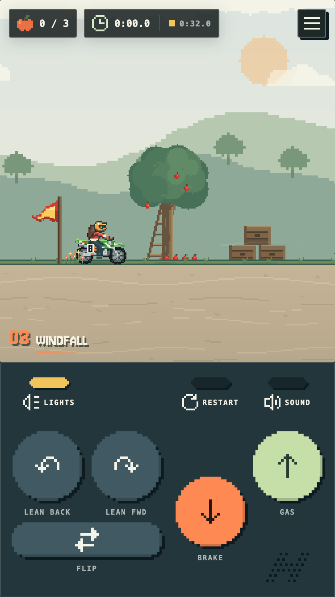

# Hjulben

[](https://h.julben.dk)

**Play it in your browser at [h.julben.dk](https://h.julben.dk).**

<p align="center">
  <a href="https://h.julben.dk"></a>
</p>

Hjulben is a small side-scrolling motorcycle trials game inspired by the physics-driven handling of **Elasto Mania**. Build momentum over rolling terrain, shift the rider's weight, control wheelies and stoppies, collect every apple, and reach the finish flag without putting the rider's helmet into the ground.

It runs in the browser with no build step and no runtime dependencies, built with native JavaScript modules, Canvas rendering, and custom Verlet-style bike physics.

## Features

- Momentum-driven motorcycle handling
- Rear-wheel-only throttle
- Progressive throttle and speed-dependent torque
- Combined braking with dynamic front-wheel bias
- Rider weight transfer, wheelies, and stoppies
- Independent front and rear suspension animation
- Impact-sensitive suspension compression and landing rebound
- Live post-crash rider ragdoll that keeps the bike's spin when thrown, with a weighted body, limited neck, hip, elbow and knee joints, ground grip, and collisions with the crashed bike, which keeps colliding with the ground and can still hang from a ledge; a hard enough hit to the head knocks the helmet off, which tumbles, rolls, floats and bumps into the bike on its own, leaving the rider bare-headed
- Direction flipping with an animated rider and bike transition
- Code-drawn pixel presentation with smooth terrain, mountains, and apples for readability
- Responsive mobile and expanded desktop layouts with optional fullscreen play
- Keyboard, touch, and gamepad controls with remappable keys
- Ghost of your best run, or the world's best, with split deltas at each apple
- Results screen with rank, personal best, flips, and gold/silver/bronze medal targets
- The next medal still in reach shown quietly beside the timer while you ride
- Watch replays: your own run from the results screen, and your device's best or the world's best from the leaderboard
- Reaching the finish with apples missing points out where they are
- The run timer starts on your first input
- Installable as an offline-capable web app
- Rider customization: gender and skin tone picked once when creating a rider, then hair, helmet (full face, motocross or none), outfit and bike, each with its own colour, changeable any time in the Garage, plus a custom rider name. Some items are won: the Pocket Classic bike for gold medals on 8 trails, and the motocross helmet for finishing The Bonny Tyler
- Elasto Mania-style pixel dirt bike, and the original Pocket Classic bike to win
- Layered foreground and background scenery
- A full day cycle, set per trail by the hour, from night through dawn, morning, noon and evening to dusk, with the moon and stars at night
- Pixel lighting at every time of day: ground stays bright by day and sinks into darkness at night, caves closed off by a back wall are dark at any hour while open hollows let the sky through, a headlight you can switch off that stays on the bike through flips and loops, lanterns, lamps, glowing mushrooms, and lightning light the way
- Terrain-colored wheel spray, brake lights, and fading ground skid marks
- Procedural engine, braking, wheel-landing, aerial trick, collectible, crash, flip, finish, dashboard, and rain sound effects
- Collectibles, finish gates, timers, and best times
- Persisted settings and trail progression
- A career of progressively longer and harder trails with gaps, caves, water, and floating blocks to ride across
- Bonus trails outside the career, often made by other riders, with their own best times and world boards, some unlocked by finishing trails or winning gold medals
- Grass, dirt, sand, concrete, stone, snow, brick, wood, and glass terrain materials
- Per-trail weather: sun, clouds, fog, rain, snow (together for sleet), lightning, and a wind with its own strength and direction that blows the rain, snow and props the same way, with procedural rain and wind ambience and distance-aware thunder
- Water you can ride through: shallow fords drag the bike and slow it down, deeper water wipes the rider out, and the ragdoll floats on the surface with splashes, wakes and sound; water lilies, reeds, seaweed, fish that dart off and ducks that take off when you come close
- Squirrels that run to the nearest tree, climb it and hide in the crown when you come close
- Coda the corgi, who trots over to greet you with a woof, and sits and pants when you press `E`
- 57 achievements for each rider, from career milestones and stunts on any trail (custom ones too), such as wheelies, big air and beating the world-best ghost, to lifetime totals like 100 crashes, announced as you earn them and listed in the menu. Secret ones stay hidden until earned

## Requirements

Playing needs a current browser:

| Browser                    | Minimum version |
| -------------------------- | --------------- |
| Safari (macOS, iOS/iPadOS) | 16.5            |
| Chrome, Edge               | 112             |
| Firefox                    | 117             |

The floor is set by native CSS nesting in `css/game.css` (see [Stylesheets](CONTRIBUTING.md#stylesheets)). The game also relies on JavaScript modules, `structuredClone` and `dvh` units, which these versions all support. There is no fallback: an older browser silently drops the nested rules, which breaks the phone layout and button states. The trail editor also uses `:has()`, so it needs Firefox 121 or newer.

Development needs Node.js 24 (the version CI uses) and npm. The game itself has no build step; npm packages are only used by the scripts and the Netlify functions.

## Play

Play online at [h.julben.dk](https://h.julben.dk). To run it locally, start a static server from the project directory:

```sh
npm run dev
```

This starts a small dependency-free Node server at `http://127.0.0.1:8080` (override with `PORT=…`). It generates `trails/catalog.json` (official and bonus) and the git-ignored `trails/custom-catalog.json` (custom), regenerates them when a trail JSON file changes, and lets the editor save trails straight into `trails/official/`, `trails/bonus/` and `trails/custom/`. It never reloads the page on its own, so a running game is not interrupted; refresh manually after changing code. The "Update ready" prompt a release shows players is left out on `localhost`, where every reload already gets the latest code; use a non-local address to see it.

A local server is required because the game uses native JavaScript modules and fetches trail JSON, which browsers block on `file://`. Any static server also works for playing, for example on a static host, but only `npm run dev` enables saving trail files from the editor.

## Controls

| Action                           | Keyboard                                  | Touch                                       |
| -------------------------------- | ----------------------------------------- | ------------------------------------------- |
| Gas                              | `Up Arrow` or `W`                         | Gas button                                  |
| Brake                            | `Down Arrow` or `S`                       | Brake button                                |
| Lean backward / forward          | `Left Arrow` / `Right Arrow` or `A` / `D` | Lean buttons                                |
| Flip riding direction            | `Space`                                   | —                                           |
| Headlight on / off               | `L` (remappable)                          | Lights button in the control area           |
| Restart trail                    | `R`                                       | Retry under the crash notice, or in the menu |
| Pause / resume                   | `P`                                       | Pause button                                |
| Open / close the main menu       | `Escape`                                  | In-game menu button                         |
| Toggle fullscreen                | `F` (remappable)                          | Fullscreen On/Off in Settings               |
| Tell Coda the corgi to sit       | `E` (remappable), when he is close        | Tap the game                                |
| Navigate dashboard controls      | Arrow keys or `W` / `A` / `S` / `D`       | Tap a menu item                             |
| Activate the focused menu action | `Enter` or `Space`                        | Tap a menu item                             |

Lean labels adjust to the direction the rider is facing. Every keyboard action can be rebound under **Settings → Keys**. Holding restart freezes the bike until you let go, so you can line up a clean start.

Gamepads use the standard mapping: `RT` or `A` for gas, `LT` or `X` for brake, the left stick or d-pad to lean, `B` to turn around, d-pad up for the headlight, d-pad down to tell Coda to sit, `Y` to restart, and `Start` to pause. In menus, the d-pad or stick moves the selection, `A` confirms, and `B` goes back.

## Trails

The career starts with gentle rollers that teach throttle rhythm and balance, then builds through turning around, steep climbs, committed jumps, hard braking, caves, water and weather to long technical trails that combine everything. Bonus trails sit outside the career.

How the career is designed, and the rules every trail follows, are in [`TRAILS_GUIDE.md`](./TRAILS_GUIDE.md). The trails still to build are in [`TRAILS_PLAN.md`](./TRAILS_PLAN.md).

Each trail requires collecting every apple before the finish gate will open. Completing a trail unlocks the next one. Selecting a trail starts it immediately, and its number and name remain visible as a lower-left course marker.

## Trail editor

Open the visual editor from **Trail Editor** on the main dashboard or navigate directly to `editor.html`. The left column has two tabs:

- **Tools**: tools grouped into Navigate, Terrain, Objects, and Course. Picking a tool shows its settings (for example block material, spike radius and spin, water width and depth, or prop type) before anything is placed. New objects use those settings, which are remembered between sessions. `V` or `Escape` selects, and `H` pans.
- **Trail**: trail name, finish and fall positions, and weather.

The inspector on the right edits the current selection. The editor supports:

- Loading every official, bonus and custom trail, with its source clearly labeled
- Drawing terrain blocks and cutting caves, entrances, and gaps into them, freehand or, holding `Alt`, as rectangles and, holding `Cmd`/`Ctrl`, as circles; `Shift` snaps to the grid
- Drawing and cutting back walls: the Block and Cut tools have a **Layer** picker (Terrain or Back wall), the inspector switches a selected block between layers, and **Fill caves with back walls** closes off the selected block's caves
- Dragging block points and curve handles, switching edges between straight and curved, and moving whole blocks (once selected, a block drags from anywhere inside it; `Esc` or `Cmd`/`Ctrl`+`D` deselects, and `Shift`-click adds or removes a block, point or object); holding `Shift` snaps the point or corner you hold to 15° steps and the grid
- Scaling selected blocks with the handles around them: corners keep the proportions, so a circle stays a circle, sides stretch one way, `Alt` scales from the centre and `Shift` snaps to the grid
- Double-clicking a block edge to insert a point
- Placing freely positioned apples, start points, props, and finish positions
- Moving or removing props and changing their type and foreground/background layer
- Placing spinning spike hazards and editing their radius and spin speed
- Drawing water bodies with the **Water** tool (`W`): drag a rectangle, or click to drop one of the tool's size. Drag a body by the middle of its surface, resize it with the scale handles, and set its width and depth in the inspector, which says whether it is a rideable ford or deep enough to wipe the rider out
- Choosing the start position and left/right facing direction
- Selecting the base and per-block materials
- Setting the time of day by the hour, with Morning, Noon, Evening and Night help points, and the backdrop
- Editing sun, cloud, fog, rain, snow, lightning, wind strength and direction values, from weather presets or one by one, with a windsock showing the wind
- Trackpad navigation: two-finger scrolling pans and pinch gestures zoom around the pointer
- Mouse navigation: wheel panning, `Ctrl`/`Cmd` + wheel zooming, and middle-button or `Space`-drag panning
- Zooming from 10% up to 600%, with a finer snap grid when zoomed in
- Clicking again where points and objects overlap selects the next one there
- Undo and redo
- Copy, cut and paste (`Cmd`/`Ctrl` + `C`, `X`, `V`) for blocks, apples, props, spikes and water. The copy goes to the system clipboard, so it can be pasted into another trail or tab; it lands under the cursor, or in the middle of the view.
- Box-select picks up whole blocks along with points and objects; `Shift`-click adds or removes one (for example a prop inside a selected block), `Cmd`/`Ctrl` + `A` selects everything, and `Cmd`/`Ctrl` + `D` selects nothing. Undo and redo restore the selection too.
- Play testing in place (`Cmd`/`Ctrl` + `Enter`); add `Shift` to start the bike where the mouse is, without moving the trail's start
- Press `?` (or **Keyboard shortcuts** in the **⋯** menu) for a list of every shortcut.
- Continuous trail validation, listed in the **⋯** menu, which shows a badge when there are errors or warnings
- Browser-local draft history (**Save draft** in the header, `Cmd`/`Ctrl` + `S`): up to 12 timestamped drafts per trail. The editor opens the newest draft unless the trail was saved after it. The label next to the trail picker shows which version is open (original, published, or a draft) and whether it has edits since; click it to open **Versions**, where you can open any draft, delete drafts, or revert to the published trail (undoable). **Save draft** is greyed out until the trail changes from the open version, and **Publish** until it differs from the published trail. The inspector panel is hidden until something is selected.
- Autosave: unsaved edits are kept in the browser a second after each change, and when the tab is closed, hidden or switched to another trail. Reopening the trail restores them on top of the version they were made to, with one undo step back to that version. The autosave is a single slot per trail, separate from the drafts, and is cleared when you save a draft or publish. Drafts and autosaves are kept compressed in the browser's IndexedDB, so even very large trails fit.
- JSON import, plus JSON and JavaScript module export (**Import / export** in the **⋯** menu, which warns when validation errors would block an export)
- **Copy share link** in the **⋯** menu: copies a link that opens the trail in the game. The whole trail is packed into the link's hash (`index.html#trail=1.<data>`: the trail JSON, deflated and base64url-encoded, see `js/trail-link.js`), so it needs no server and works on any deployment. Opening the link rides the trail straight away and saves it under **Custom Trails** (opening it again reuses that copy). Small trails make links of a few hundred characters, but bigger ones run to several thousand, and the editor warns when a link is too long for a Discord message (2,000 characters). Because the hash never reaches the server, chat apps can't show the trail's name or a picture in their link preview.
- **New** (+) and **Duplicate** next to the trail picker, plus **Publish** (`Cmd`/`Ctrl` + `Shift` + `S`) and **Delete** in the **⋯** menu

Where **Publish** writes depends on how the editor is served:

- Under `npm run dev`, official, bonus and file-based custom trails are written directly to their JSON file, and new trails are created in `trails/custom/`. For an official or bonus trail the menu item reads **Overwrite official file…** or **Overwrite bonus file…** and asks for confirmation first.
- On any other server, official and file-based trails are read-only. **New** and **Duplicate** create custom trails stored in the browser (IndexedDB, compressed, so even very large trails fit), which then appear under **Custom Trails** in the game. Players can also add trails with **Import trail** in the game's trail menu.

Editor drafts do not overwrite trail files. Official trails live in `trails/official/`, bonus trails in `trails/bonus/`, and locally authored trails belong in `trails/custom/`. Both use the exact JSON format produced by **Export JSON**. Source classification comes from the generated catalog and folder—not from a user-editable property inside the trail. See [`TRAIL_FORMAT.md`](./TRAIL_FORMAT.md) for the full schema and design guidelines.

## Settings and saved data

The dashboard's Settings view includes:

- Full or reduced scenery
- Visible or hidden on-screen controls
- Sound effects on or off, and master volume
- Screen shake (off by default when the system prefers reduced motion)
- Vibration on landings and crashes (on devices that support it)
- Ghost: your best run, the world's best (falls back to yours offline, and races whichever is faster), or off
- Keyboard bindings
- Fullscreen mode

The game opens on a dedicated dashboard before any trail is loaded or rendered. Settings, trail selection, and an illustrated How to Play guide are full dashboard views rather than separate modals. Control instructions are centralized in the guide instead of being repeated around the gameplay interface. It provides three independent savegame slots. The dashboard has one orange call to action: Resume Ride while a ride is paused, otherwise Continue for the active rider, or Start Riding on a first visit, which goes straight to naming a rider. The Riders view lists every slot: pick a rider to make it active, use an empty slot to create a new one, or delete a rider to free its slot. Saves are never overwritten. A new rider first picks a name, gender and skin tone (Light by default); these are fixed once the rider exists. Gender also sets face details and a suggested starting look, but every style stays open to everyone. A few items are won through career progress instead (the Pocket Classic for gold medals on 8 trails, the motocross helmet for finishing The Bonny Tyler); until then they show a padlock, and tapping one in the Garage says what unlocks it. The rider then picks a style and colour for hair, helmet, outfit and bike, and can change those any time from **Garage** on the dashboard. Riding without a helmet only changes how a crash looks, never the run. Saves from before looks existed keep their old rider as a look.

Preferences and all three rider profiles—including each slot's current trail, unlocks, and best times—are stored in browser `localStorage`.

Current storage keys:

- `hjulben-settings-v1`
- `hjulben-saves-v2`
- `hjulben-active-slot-v1`
- `hjulben-leaderboard-v1`
- `hjulben-ghost-v1:<trail>` (inputs of the best run, re-simulated as the ghost)
- `hjulben-pending-runs-v1` (finished runs still to be posted to the world board)

Ghosts and local boards of a shipped trail's earlier versions are removed at start-up, as are ghosts from an older physics version; when storage is full the game says so and keeps going with what it has.

The dashboard's Leaderboard view ranks the ten fastest finishes per official, bonus and custom trail across all savegames on the device. Runs remain on the board after their savegame is deleted. Step between trails with the arrows, or click the trail name to pick one from a list. Each run shows its date, including the year. Every trail is keyed by a hash of what decides a run (terrain, start, finish, apples, spikes, and water), and official and bonus trails also by their id (`official:<id>@<hash>`, `bonus:<id>@<hash>`). Editing a trail's gameplay starts fresh leaderboards, ghosts and best times, online and local, while renaming it or changing its props keeps them.

Clearing site data resets settings, progression, and recorded times. Online riders can get theirs back by logging in (see below).

## Online riders and the world leaderboard

When creating a rider, players choose **Online** (the default) or **Offline**:

- **Online** riders sign up with a **passkey** (fingerprint, face or device PIN). No email or password is involved. The name is reserved for them on the world leaderboard. Names are unique regardless of case, accents, spaces, `_`, `.` and `-`, and offensive or reserved names are refused. Progress is backed up to the server. After clearing site data, or on another device with the same passkey (synced through iCloud, Google or a password manager), **Log in with passkey** on the dashboard or in Riders restores the save, best times and ghosts.
- **Offline** riders stay in the browser and never appear on the world board. **Go Online** in Riders claims the name later and uploads the rider's best runs.

Deleting a slot with × only frees it on that device; the online rider, their cloud save and their world times stay, and logging in brings them back. **Delete Online** in Riders removes the rider from the server for good (name, cloud save, passkeys and world-board runs), after confirming with their passkey, and frees the name.

The world board doesn't trust times sent by the browser. A finished run is sent as its recorded inputs. The server replays them through the same deterministic simulation (`js/ride.js`) against the official or bonus trail, checks that it finishes, and uses its own time. It keeps each rider's best run per trail, and its replay becomes the ghost when restoring a save. A run that can't be posted (offline, or the server didn't answer) is kept in `hjulben-pending-runs-v1` and sent the next time the dashboard opens, the browser comes back online, or the rider logs in. A run ridden in slow motion, because the device couldn't keep up with the physics, is kept on the device but not posted. Each rider may post a dozen runs a minute, and each address may start twenty passkey ceremonies a minute (`netlify/lib/rate-limit.mjs`).

The cloud save is merged on the server rather than replaced: best times keep the faster, progress and lifetime stats the higher, achievements and nisse finds the union, so a device that uploads a stale copy never wipes out another device's progress. Sessions last 180 days; one used in its last 30 days gets a fresh token with the reply, so a rider who keeps playing is never signed out.

## Technical overview

### Physics

The bike connects Verlet-integrated wheels through compliant suspension to a rigid XPBD chassis triangle. The simulation runs at a fixed 120 Hz step and includes:

- Gravity, static overlap correction, and swept circle collision
- Angular wheel dynamics and contact-slip traction
- Progressive throttle pressure
- Speed-dependent engine torque
- Slope-aware climbing torque
- Front-biased combined braking
- Rider lean torque and weight transfer
- Momentum preservation in the air and on the ground
- Impact-dependent restitution
- Independent physical and visual suspension state for each wheel

The physics are deliberately game-oriented rather than a complete real-world motorcycle simulation.

### Terrain and trails

Terrain is a list of `terrainBlocks`: connected pieces of solid bounded by straight or curved edges, which may contain caves. Blocks can be any shape, so they cover rolling ground, floating ledges, overhangs, and loops. Each block is compiled into polygons once, and rendering, collision, validation, and the editor all use that same geometry. Wheel collision resolves against the nearest edge or corner, including steep faces and undersides, and gaps are simply breaks between blocks. Trails can also define collectibles, props, visual colors, a finish position, and weather.

See [`TRAIL_FORMAT.md`](./TRAIL_FORMAT.md) for the complete schema, coordinate system, examples, and design guidelines. Physics status, test coverage, and profiling notes are in [`PHYSICS.md`](./PHYSICS.md). Configure rain and lightning independently with `weather: { rain: 0–1, lightning: 0–1 }`. Either property can be omitted, so a trail may have rain, lightning, both, or clear weather.

### Rendering

Everything is rendered with the Canvas 2D API. The gameplay and illustrated How to Play guide share the same rider, bike, apple, and finish-flag renderers, so visual updates remain synchronized. Rendered elements include:

- Terrain blocks, caves, and floating ledges
- Back walls: scenery behind the terrain that keeps caves dark
- Modular pixel bike, rider, wheels, and suspension. Bike models are listed in `BIKE_MODELS` in `js/drawing.js` and chosen with the `bike` option of `drawBike`, or by the rider's look (`js/cosmetics.js`). `elasto` is the default and `classic` is the original bike. Each model's headlight and tail light are pixel art in `BIKE_LAMPS` (`js/bike-lamps.js`); the art draws them and the lighting shines from their lenses, so a new model only needs an entry there
- Smooth vector apples and pixel finish gates
- Layered pixel props and particles
- Pixel terrain with anchored pixel mountain silhouettes
- Layered pixel foreground and atmospheric scenery shared by gameplay and the dashboard
- Pixel ground-following shadows

The logical viewport and camera framing adapt to mobile and desktop dimensions.

## Contributing

Setting up for development, testing, the code layout, style conventions, the online backend and releasing are covered in [`CONTRIBUTING.md`](./CONTRIBUTING.md).

## Roadmap ideas

- [ ] Music
- [ ] Add import / export of savegames
- [ ] Add background: Coast (a sea horizon with an island)
- [ ] Moving and interactive obstacles
- [ ] Grip. Right now every material has the same grip, because WHEEL_FRICTION is a single value. If you want sand to feel softer or more slippery, per-material grip can be added. It would change how runs replay, though, so you'd need to raise RIDE_VERSION and re-record the replays.
- [ ] Short share links and online leaderboards for shared trails. Share links are static for now (see **Copy share link** under [Trail editor](#trail-editor)). A Netlify function could store each shared trail in Neon under its content hash (`trailHash` plus a few characters, so sharing a trail twice gives the same link) and hand out `/t/<id>` links. Those stay short at any trail size, and the `/t/<id>` page can carry `og:` tags with the trail's name, author and a thumbnail, so Discord and Reddit show a proper preview. That id would also give each shared trail a stable key for the world board: today `verify-run.mjs` only accepts official and bonus trails, so it would need to load the stored trail by id and replay runs against it. Watch the database load first: cap trail size, rate-limit uploads, and maybe only keep trails that someone has ridden. Shared ghosts (`encodeInputs` runs in the same link) would fit here too.
- [ ] Make the ragdoll controllable
- [ ] Nice to have: a circular day dial for the time of day in the trail editor, in place of the straight slider. A custom `role="slider"` control (the native range input can't be round), dragged round a ring of the 24 hours, each segment in that hour's sky colour, with a sun or moon at the chosen hour, notches at the help points (0, 7, 12, 19) and the time in the middle. The arrow keys step an hour and wrap past midnight. The Morning/Noon/Evening/Night buttons stay. Editor only: the trail format doesn't change.

## Inspiration

Hjulben is inspired by the momentum, balance, and risk-reward handling of **Elasto Mania**. It is an original game and is not affiliated with or endorsed by the creators of Elasto Mania.
